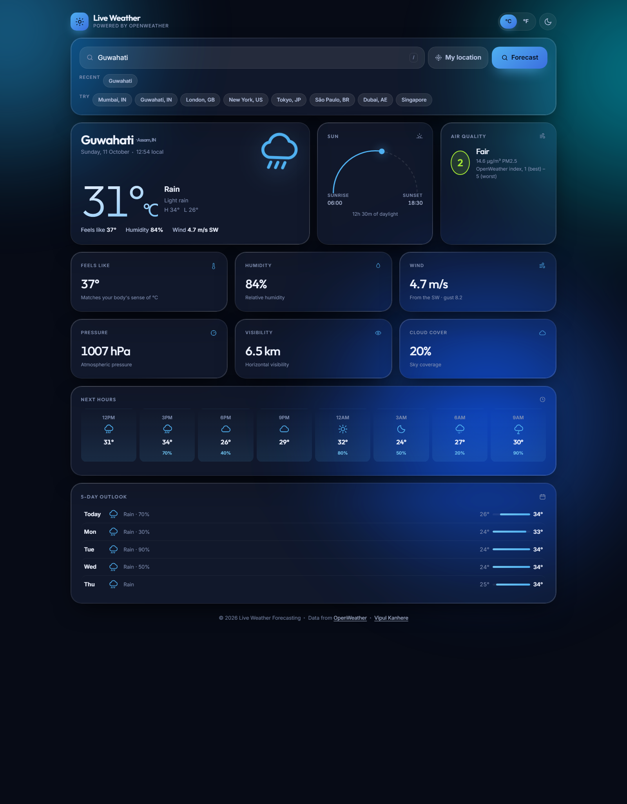
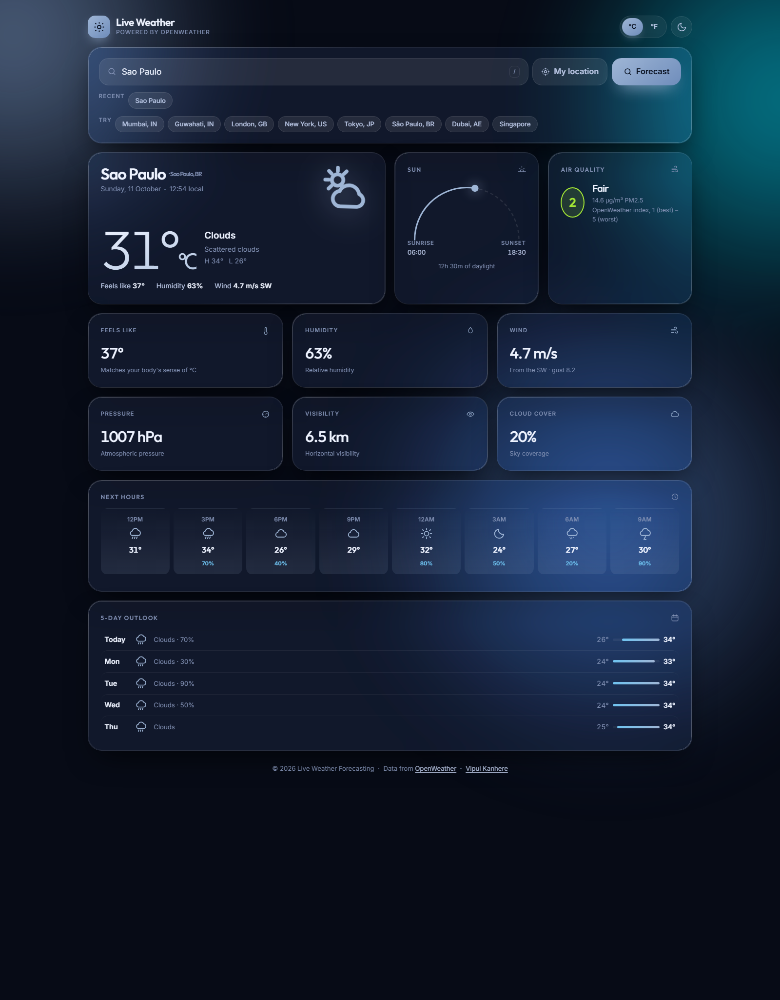
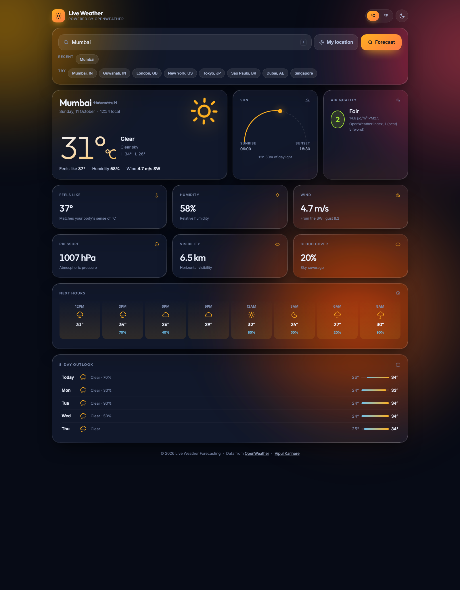

# Live Weather Forecasting

A live weather dashboard built with **JSP**, **HTML & CSS**, and plain JavaScript, powered by the
[OpenWeather API](https://openweathermap.org/api). Search any city on earth — or use your current
location — and get live conditions, an hourly outlook, a 5-day trend and air quality in one
glass-panelled bento dashboard.

---

## Screenshots

| Guwahati, India | São Paulo, Brazil | Mumbai, India |
|:--:|:--:|:--:|
|  |  |  |

> Captured from the redesigned interface. The background and accent colours adapt automatically to
> the current conditions and to day/night.

**Raw demo video:** [LiveWeatherForecastingAPIGlobal2.mp4](./LiveWeatherForecastingAPIGlobal2.mp4)

---

## Features

**Weather data**
- Search by city name, or one-tap **My location** (browser geolocation)
- Current conditions: temperature, feels-like, condition, high/low
- Hourly outlook for the next 24 hours, with precipitation probability
- 5-day outlook with daily high/low range bars
- Air quality index (OpenWeather 1–5 scale) with PM2.5
- Sunrise/sunset with an animated day arc and daylight duration
- Metric tiles for humidity, wind (speed, direction, gusts), pressure, visibility and cloud cover
- °C / °F toggle

**Interface**
- Liquid-glass panels with specular edge highlights over an animated aurora mesh background
- Weather-reactive theming — the palette follows the sky and switches for day/night
- Responsive bento grid that reflows from 12 columns down to a single column
- Light and dark modes, remembered between visits
- Inline SVG weather icons, no icon-font or image dependencies
- Recent-search chips saved on your device
- Keyboard shortcut: press <kbd>/</kbd> to jump to the search field

**Craft**
- Accessible: semantic landmarks, a skip link, ARIA live labels, visible focus rings
- Honours `prefers-reduced-motion` (all animation switches off)
- Cross-document View Transitions where supported
- Graceful states for missing API key, unknown city, and network failure
- Untrusted input is HTML-escaped before it reaches the page

---

## Tech stack

| Layer | Choice |
| --- | --- |
| View | JSP (Java Server Pages), server-rendered |
| Styling | Hand-written CSS — cascade layers, `clamp()`, `color-mix()`, container-friendly grid |
| Behaviour | Vanilla JavaScript, no framework or build step |
| HTTP | `HttpURLConnection` |
| JSON | [json-simple 1.1.1](https://github.com/fangyidong/json-simple) |
| Runtime | Tomcat 9 (Servlet 4 / `javax.servlet`), JDK 17 |
| Hosting | Docker on [Render](https://render.com) |

---

## Project structure

```
.
├── weather.jsp            # the entire application (one file)
├── Dockerfile             # Tomcat 9 image for deployment
├── docker/setenv.sh       # maps $PORT to Tomcat's connector
├── docker-compose.yml     # local preview
├── render.yaml            # Render Blueprint
└── *.png, *.mp4           # screenshots and demo video
```

---

## Configuration

The app reads its API key from the environment. It is never hard-coded, never sent to the browser,
and never committed.

| Variable | Required | Default | Purpose |
| --- | --- | --- | --- |
| `OPENWEATHER_API_KEY` | **yes** | — | Your OpenWeather API key |
| `OPENWEATHER_BASE_URL` | no | `https://api.openweathermap.org` | Override for testing against a stub |
| `PORT` | no | `8080` | Port Tomcat binds to (set automatically by Render) |

If `OPENWEATHER_API_KEY` is missing, the app still runs and shows an in-page setup guide instead of
failing.

---

## Getting an OpenWeather API key

1. Sign up (free) at <https://home.openweathermap.org/users/sign_up>.
2. Confirm your email address.
3. Open <https://home.openweathermap.org/api_keys>. A default key already exists — or click
   **Generate new key** and name it `live-weather`.
4. Copy the 32-character key.
5. **A brand-new key can take up to ~2 hours to activate.** Until then the API returns
   `401 Invalid API key` — that is normal, not a bug in the app.

The free tier is more than enough: roughly 60 calls/minute and 1,000,000 calls/month.

---

## Run locally

### Option A — Docker (closest to production)

```bash
docker compose up --build
# open http://localhost:8080
```

Put your key in a `.env` file next to `docker-compose.yml`:

```
OPENWEATHER_API_KEY=your_key_here
```

### Option B — Tomcat directly

1. Download [Tomcat 9](https://tomcat.apache.org/download-90.cgi) and
   [json-simple 1.1.1](https://repo1.maven.org/maven2/com/googlecode/json-simple/json-simple/1.1.1/json-simple-1.1.1.jar).
2. Create this layout:

   ```
   webapps/ROOT/index.jsp                        <- copy of weather.jsp
   webapps/ROOT/WEB-INF/lib/json-simple-1.1.1.jar
   ```
3. Start Tomcat with the key in the environment:

   ```bash
   export OPENWEATHER_API_KEY=your_key_here
   export OPENWEATHER_BASE_URL=http://127.0.0.1:9999   # optional, only for testing
   bin/catalina.sh run
   ```
4. Open <http://localhost:8080/>.

### Option C — Eclipse / Java EE

1. Create a **Dynamic Web Project**.
2. Drop `weather.jsp` into `WebContent/` (or `src/main/webapp/`).
3. Add `json-simple-1.1.1.jar` to `WebContent/WEB-INF/lib/`.
4. Run on a Tomcat 9 server, passing `OPENWEATHER_API_KEY` in the launch configuration's
   environment.

---

## Deploy to Render

The repo ships a `Dockerfile` and a `render.yaml` Blueprint, so deployment is:

1. Push this repo to GitHub (already done if you are reading it there).
2. Go to <https://dashboard.render.com> and sign in **with GitHub**.
3. Click **New → Blueprint** and pick this repository.
4. Render reads `render.yaml` and prompts for the one secret it needs —
   paste your key into **`OPENWEATHER_API_KEY`**.
5. Click **Apply**. The first build takes a few minutes; after that, every push to `main`
   redeploys automatically.

Your app will be live at `https://<service-name>.onrender.com`.

> **Free-tier note:** Render's free web services spin down after ~15 minutes of inactivity, so the
> first request afterwards takes a few seconds to wake up.

To change the key later: **Render Dashboard → your service → Environment → edit
`OPENWEATHER_API_KEY` → Save changes**.

---

## How the data flows

```
city name ──▶ Geocoding API ──▶ lat / lon
                                   │
                                   ├─▶ /data/2.5/weather          → current conditions, sun times
                                   ├─▶ /data/2.5/forecast         → hourly + 5-day outlook
                                   └─▶ /data/2.5/air_pollution    → AQI + PM2.5
```

All three requests happen server-side on each search, and all times are converted to the
**searched city's** local timezone rather than the server's.

---

## Author

- [Vipul Kanhere](https://github.com/V1PU1LXRD)

Weather data by [OpenWeather](https://openweathermap.org/).
